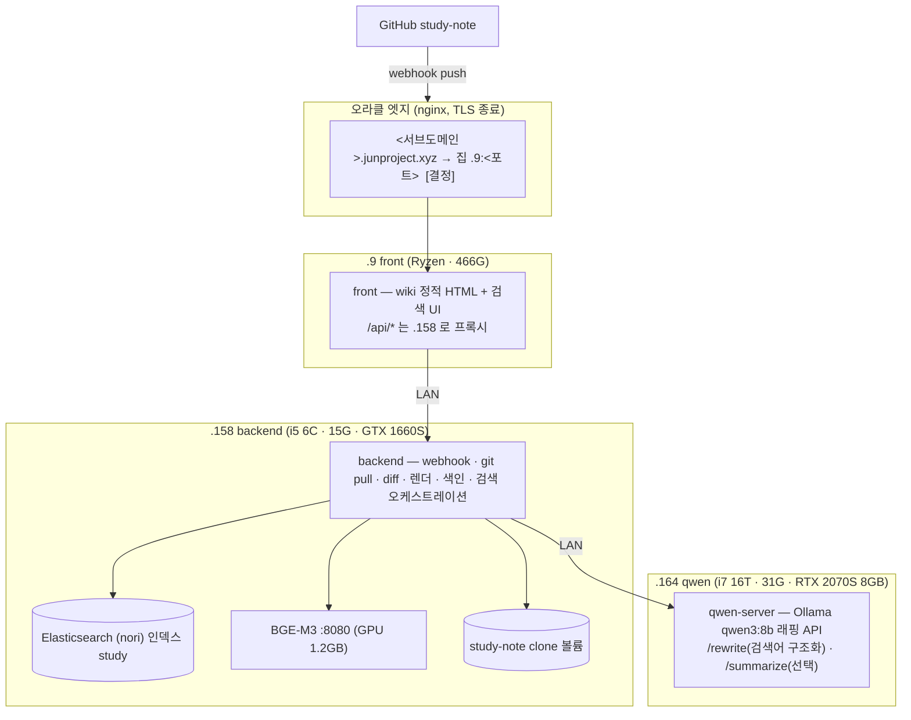

# deploy-study-note — study-note 위키 자동 배포 + 검색

> `study-note`(공부 노트 md 저장소)에 push 하면 **자동으로 wiki 사이트에 배포**되고, 바뀐 문서만 **ES에 색인·임베딩**되어
> **로컬 LLM(Qwen3)이 검색어를 해석해 ES를 검색**하는 시스템. 초안 2026-08-23 — 결정 필요 항목은 `[결정]` 표시.

## 0. 한 줄 흐름

```
study-note push ──▶ GitHub ──webhook──▶ 이 프로젝트 API (.9)
                                          ├─ ① git pull
                                          ├─ ② git diff (이전 SHA..HEAD) → 추가/수정/삭제 md 목록
                                          ├─ ③ md → HTML 렌더 + 인덱스(트리) 재생성 → wiki 정적 서빙
                                          └─ ④ 변경 문서만 ES upsert/delete (본문 + BGE-M3 임베딩)

사용자 검색어 ──▶ Qwen3(.164) 검색어 해석·재작성 ──▶ ES 하이브리드(BM25 nori + kNN) ──▶ 결과 + 문서 링크
```

## 1. 입력 — study-note 현황 (2026-08-23 실측)

| 항목 | 값 |
|---|---|
| 원격 | `https://github.com/junhyeong9812/study-note.git` (72 커밋) |
| 규모 | **md 622개 / 3.7MB** — 주제 11개 (data-structure 107 · programmers 94 · domain-modeling-basic/advanced 92·92 · algorithm 92 · ops-patterns 59 · cs 43 · api-design 20 · reference 12 · db-engine-lab 5 · 세미나 1) |
| 구조 규약 | `<주제>/README.md`(규칙) + `index.md`(챕터 목록·진행 상태) + `<챕터>/{1-question,2-summary,3-answer}.md` |
| 로컬 | `/home/jun/project/study-note` |

→ 규약이 고정돼 있어 **폴더 트리 = wiki 네비게이션**, `index.md` = 주제 목차, 챕터 = question/summary/answer 3탭으로 그대로 매핑 가능.
→ 3.7MB·622개면 첫 색인도 수 분 내 — 증분 갱신은 커밋당 몇 개 파일 수준.

## 2. 구성요소와 배치 — 서버 1대 = 역할 1개

**local-llm·Readlog는 전부 정리**하고 **jun-bank 관련만 남긴다** — 그 자원·포트를 이 프로젝트가 이어받는다(정리 범위는 §7). 오라클 엣지·3대 서버·키·포워딩은 그대로.



| 호스트 | 역할 | 구성요소 | 자원 근거 |
|---|---|---|---|
| **.9** | **front** | wiki 정적 서빙 + 검색 UI + `/api/*` → .158 리버스 프록시. **외부 노출 유일 지점** | 포워딩이 .9로 잡혀 있음. CPU 약해도 정적 서빙엔 충분. jun-bank 배정분(13000·14000)과 공존 |
| **.158** | **backend** | webhook·git·렌더·색인·검색 API + ES + BGE-M3 + repo 볼륨 | GPU(임베딩) 보유, 6C·13Gi 유휴, 디스크 168G(코퍼스 3.7MB) |
| **.164** | **qwen** | Ollama(신규 설치) `qwen3:8b` + 얇은 래핑 서버(프롬프트·JSON 스키마·타임아웃 고정) | 2070S 8GB, 31G RAM. 디스크 정리 후 **79G 여유** |
| 오라클 | 엣지 | 서브도메인 1개 → .9 | conf 1개 추가, www/admin/mcp conf 제거 |

**렌더된 HTML을 .158에서 .9로 옮기는 방식** `[결정]`: (a) backend가 렌더 후 rsync/scp로 .9 볼륨에 push (b) front가 .158의 정적 파일을 프록시 (c) front 컨테이너가 주기적으로 pull. 단순한 건 (b), 장애 격리는 (a).

## 3. 파이프라인 상세

### 3.1 CD — push → 배포
1. GitHub webhook(`push`, main) → `POST /hooks/github` (HMAC `X-Hub-Signature-256` 검증 — 엣지는 인증 게이트가 아니므로 앱에서 검증).
2. `git fetch && git reset --hard origin/main` (clone 볼륨). 직전 처리 SHA는 DB/파일에 보관.
3. `git diff --name-status <prev>..<HEAD> -- '*.md'` → `A/M/D/R` 목록. **git tree 기반 변경 판정**이 정본 — mtime·전체 재스캔 안 함.
4. 렌더: 변경 파일만 md→HTML(코드 하이라이트·mermaid·상대 링크 → wiki 경로 치환). 트리·`index.md`가 바뀌면 네비게이션 재생성.
5. 색인: A/M → 청크(헤더 단위) → BGE-M3 → ES `_bulk` upsert(doc id = 경로). D/R → 구 경로 delete. 커밋 SHA를 문서 메타에 기록.
6. 완료 후 처리 SHA 갱신. 실패 시 SHA 미갱신 → 다음 webhook에서 재처리(멱등: upsert by path).

### 3.2 검색 — Qwen3 + ES 하이브리드
1. 사용자 검색어 → front → backend → **qwen-server**(.164, `/rewrite`: Ollama `/no_think`, 짧은 프롬프트): **의도 분류 + 키워드 추출 + 동의어/영한 확장 + ES 필터(주제·문서종류)**를 JSON으로 반환. 7B급이라 "답변"이 아니라 **질의 구조화만** 맡긴다(local-llm 교훈: 약한 모델 + 좋은 검색).
2. 키워드 → BM25(nori) / 원 검색어 → BGE-M3 dense → kNN. 수동 RRF로 병합(local-llm `rag-api`와 동일 패턴).
3. 결과: 청크 하이라이트 + wiki 페이지 링크. (선택) Qwen3가 상위 청크 기반으로 한국어 요약 — 인출 학습 목적상 **기본은 링크만, 요약은 토글**.

### 3.3 모델 선택 — 왜 Qwen3 8B
- 2070S **8GB VRAM** → `qwen3:8b` Q4_K_M **5.2GB**, 40K 컨텍스트로 적합. 14B(Q4 ≈ 9GB)는 안 들어간다.
- Qwen3는 119개 언어 지원(한국어 포함)·thinking 토글 — 검색어 재작성엔 `/no_think`로 지연 최소화.
- 기존 `qwen2.5:7b`는 그대로 두고 **모델만 추가**(`ollama pull qwen3:8b`) — .164 디스크 34G 여유라 1개 추가는 가능, 그 이상은 정리 필요.
- `[결정]` 임베딩도 Qwen3-Embedding으로 통일할지 — 지금은 검증된 BGE-M3(.158) 재사용이 기본.

## 4. 인터페이스

| 경로 | 메서드 | 용도 |
|---|---|---|
| `/hooks/github` | POST | webhook (HMAC) — 동기 큐 적재 후 202 |
| `/api/sync` | POST | 수동 전체 재색인 (basic auth) |
| `/api/search?q=` | GET | Qwen3 해석 → ES 하이브리드 → JSON |
| `/api/status` | GET | 마지막 처리 SHA·시각·색인 문서 수 |
| `/`, `/<주제>/<챕터>/` | GET | wiki 페이지 |

ES 문서(청크): `{path, topic, chapter, kind(question|summary|answer|index|readme), heading, content, dense[1024], sparse, commit_sha, updated_at}`

## 5. 홈랩 규약 준수

- 외부 노출은 **.9 front 포트 1개**만 엣지에 붙이고 backend(.158)·ES·BGE-M3·qwen(.164)은 LAN 안(기존 경계 유지).
- 컨테이너 `healthcheck`(127.0.0.1) + `restart: unless-stopped` → 기존 metrics-agent 모니터링 자동 편입.
- 렌더·색인은 webhook당 변경분만, 전체 재색인은 수동. 호스트 간 호출(.9→.158→.164)은 전부 LAN 평문 — 인증은 front/backend 앱 계층.

## 6. 결정 필요 `[결정]`

1. 서브도메인·포트 — local-llm 정리 후 `www.junproject.xyz`:11000 을 그대로 이어받을지, `study.junproject.xyz` 신규일지
2. backend 언어/런타임 (Kotlin/Spring — `rag-api` 경험 재사용 vs 경량 Go/Python) · qwen-server 언어
3. front 정적 파일 전달 방식 (§2 a/b/c)
4. 정적 렌더러 (직접 md→HTML vs MkDocs/Docusaurus 빌드 호출)
5. 요약 기능 포함 여부(1차 범위 밖 권장)
6. ~~ES 이전~~ — `core-es`·kb 인덱스 폐기 완료, .158에 신규

## 7. 정리 — jun-bank 외 전부 **(2026-08-23 실행 완료)**

| 호스트 | 내린다 | 남긴다 |
|---|---|---|
| .9 | local-llm: `core-pg`·`core-es`(kb 14,615 docs)·`rag-api`·`rag-mcp`·`web-www`·`web-admin` · `metrics-agent`·`claude-bridge`·`intel-daily.timer` · **Readlog: `readlog-prod-app`·`readlog-prod-pg`**(12000) | jun-bank 배정분(deploy-agent 13000 · 대시보드 14000) |
| .158 | `embed-bge-m3` → backend compose로 **재편입**(이미지 재사용) · `metrics-agent` | — |
| .164 | `qwen2.5:7b` 모델(디스크 확보) · `metrics-agent` | Ollama 본체 |
| 오라클 | `www`·`admin`·`mcp`·**`readlog`** conf + 인증서(갱신 중단) | `00-map`·apex·`deploy`·`bank` |
| 공유기 | 9000·10000·**12000** 포워딩 제거 (11000은 front가 이어받을 수 있음) | 13000·14000 |

실행 결과(상세 `docs/cross-cutting/plans/2026-08-23/teardown-homelab/log.md`): 3대에서 local-llm·Readlog·실험 잔재 컨테이너/볼륨/이미지 제거. **오라클·공유기는 의도적으로 무접촉** — `www/admin/mcp/readlog` conf·인증서와 9000/10000/11000/12000 포워딩은 이 프로젝트가 재활용. 잔여: `metrics-agent.service`(3대)·`intel-daily.timer`(.9)는 sudo 필요 → 수동 정리. `~/_trash-20260823/` 1주 후 삭제.
재활용 보존: .158 `embedding-embedding` 이미지(12.4GB) + `embedding_hf-cache`(BGE-M3 가중치). Ollama는 전부 지웠으므로 .164에 **새로 설치**한다.

> 모니터링(`metrics-agent`→Spring 폴링)은 사라졌다 — 대체 모니터링은 `[결정]`(1차 범위 밖이면 healthcheck만).

## 진행 규칙 — 이해 확인 게이트

이슈 묶음이 끝나면 `study-note/project/study-note-deploy-system/<서버>/issueN/`에 정리한다.
다음 작업 착수 전에 **사용자가 그 기록·실변경을 바탕으로 Claude에게 직접 설명하고, Claude가 이해 여부를 판정(정확/누락 피드백)해 통과해야 개발을 진행한다** — 이 프로젝트의 강제 게이트.

## 문서 색인

- `docs/workflow/` — **API별 처리 워크플로우**(ASCII+절차): [sync](docs/workflow/sync.md) · [content](docs/workflow/content.md) · [search](docs/workflow/search.md) · [deploy](docs/workflow/deploy.md) · [chat(설계)](docs/workflow/chat-design.md) · [MVC vs WebFlux](docs/workflow/streaming-mvc-vs-webflux.md)
- `docs/cs/` — 용어 노트(semaphore·backoff·RESP) · `docs/logging.md` — 로그 규약 · `docs/secrets.md` — 시크릿 대장(로컬)
- 이슈 단위 구현 기록은 study-note `project/study-note-deploy-system/`(위키·검색에서 열람)

## 8. 폴더 / 리포

| 폴더(=개인 리포명) | 호스트 | 역할 |
|---|---|---|
| `study-note-deploy-system-front` | .9 | wiki 정적 서빙 + 검색 UI |
| `study-note-deploy-system-backend` | .158 | webhook·git·렌더·색인·검색 API |
| `study-note-deploy-system-llm` | .164 | Ollama qwen3 래핑 API |
| `study-note-deploy-system-ci-cd` | .9 master(:15000) + 3대 agent(:15001) | Go 배포 서버 — MODE 전환 단일 바이너리. 리포 Actions(ghcr)→front 중계→master→agent compose pull/up (2026-08-29 llm E2E 가동) |

## 관련 폴더

- `project-deploy-data/` — 서버 3대·오라클 엣지·nginx conf·라우팅·SSH 키 (git 추적 금지)
